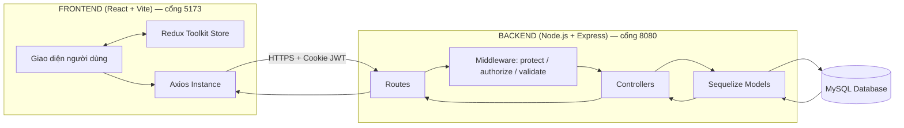
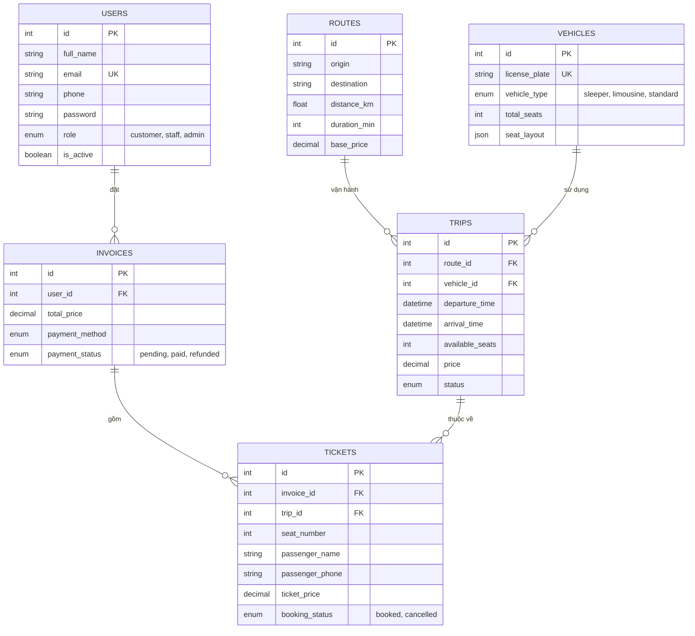
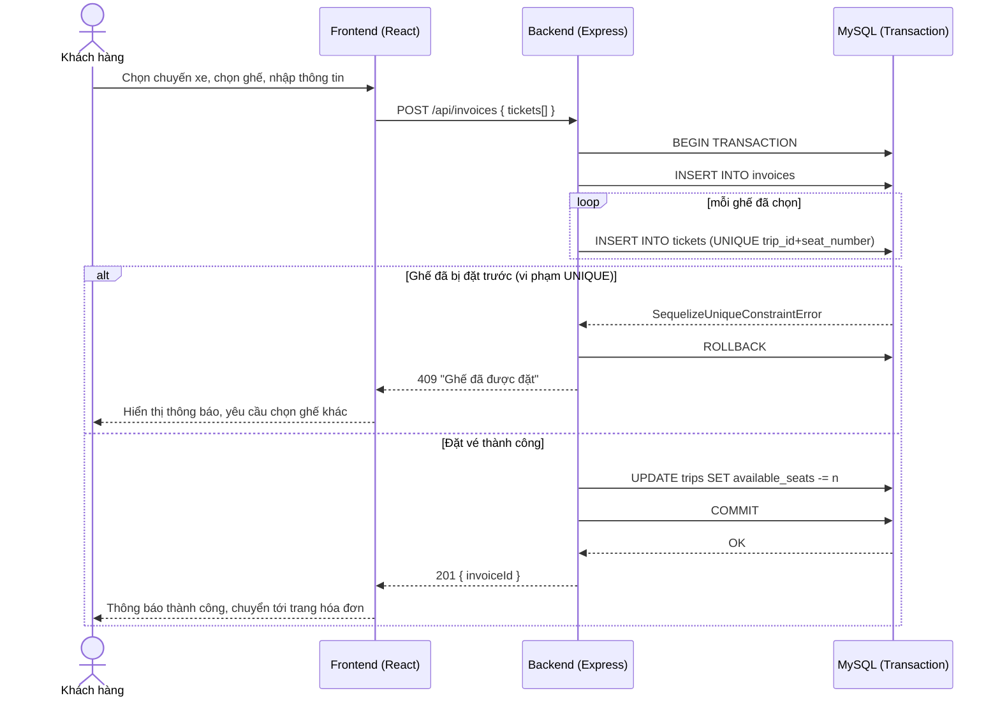

<!--
GHI CHÚ SỬ DỤNG (xóa khối này trước khi nộp):

File này là BẢN NHÁP nội dung đồ án, viết bằng Markdown để dễ chỉnh sửa.
Khi dán sang Word, áp định dạng theo đúng "Huong_dan_viet_DACS.md" như sau:

  # Chương x. TÊN CHƯƠNG   -> Times New Roman 16pt, IN ĐẬM, viết hoa
  ## x.y Tên mục            -> Times New Roman 14pt, in đậm
  ### x.y.z Tiểu mục         -> Times New Roman 14pt, in nghiêng
  #### x.y.z.t Tiểu mục con  -> Times New Roman 13pt, gạch chân
  Nội dung thường               -> Times New Roman 13pt

  Dãn dòng: 1.5 lines. Lề trên 2cm / dưới 2.5cm / trái 3cm / phải 2cm.
  Đánh số trang giữa, bên dưới. Không dùng số La Mã cho mục/tiểu mục.

Còn thiếu, bạn cần tự điền:
  - Trang phụ bìa: họ tên GVHD, họ tên & MSSV sinh viên thực hiện, lớp, khóa.
  - Lời cảm ơn (mang tính cá nhân, nên tự viết).
  - Các vị trí đánh dấu "[Chèn ảnh chụp màn hình]" — chụp màn hình thực tế
    ứng dụng đang chạy rồi chèn vào, đánh số theo đúng Hình x.y.
  - Mục lục / Danh mục bảng / Danh mục hình: sau khi áp Heading Style trong
    Word, dùng References > Table of Contents để Word tự sinh số trang.
  - Số trang trong "Danh mục" dưới đây chỉ là placeholder "..." vì phụ
    thuộc vào cách trình bày cuối cùng trong Word.
-->

# TRƯỜNG ĐẠI HỌC CÔNG NGHỆ TP.HCM (HUTECH)
## KHOA CÔNG NGHỆ THÔNG TIN

---

# ĐỒ ÁN CƠ SỞ

## ĐỀ TÀI: XÂY DỰNG HỆ THỐNG QUẢN LÝ BÁN VÉ XE KHÁCH TRỰC TUYẾN (VEXEREBUS)

**Giảng viên hướng dẫn:** [Họ và tên GVHD]

**Sinh viên thực hiện:** [Họ và tên sinh viên] — MSSV: [MSSV]

**Lớp:** [Lớp] &nbsp;&nbsp;&nbsp; **Khóa:** [Khóa]

TP. Hồ Chí Minh, 2026

---

## LỜI CAM ĐOAN

Tôi xin cam đoan đây là công trình nghiên cứu và xây dựng của riêng tôi dưới sự hướng dẫn của [Họ và tên GVHD]. Các số liệu, kết quả trình bày trong đồ án là trung thực, được thực hiện trên hệ thống thực tế do tôi trực tiếp thiết kế, cài đặt và kiểm thử. Các đoạn mã nguồn, thư viện và tài liệu tham khảo bên ngoài được sử dụng trong đồ án đều được trích dẫn đầy đủ trong mục Tài liệu tham khảo. Tôi hoàn toàn chịu trách nhiệm về tính trung thực của nội dung đồ án này.

TP. Hồ Chí Minh, ngày ... tháng ... năm 2026

Sinh viên thực hiện

*(Ký và ghi rõ họ tên)*

---

## LỜI CẢM ƠN

*(Phần này mang tính cá nhân, sinh viên tự viết lời cảm ơn Khoa, Nhà trường, Giảng viên hướng dẫn và những người đã hỗ trợ trong quá trình thực hiện đồ án.)*

---

## MỤC LỤC

```
Trang phụ bìa
Lời cam đoan
Lời cảm ơn
Mục lục ............................................................................... i
Danh mục các ký hiệu, các chữ viết tắt ............................... ii
Danh mục các bảng ................................................................ iii
Danh mục các hình vẽ, đồ thị ................................................ iv

Chương 1. TỔNG QUAN ..................................................... 1
  1.1 Đặt vấn đề .................................................................... 1
  1.2 Mục tiêu đề tài .............................................................. 2
  1.3 Đối tượng và phạm vi nghiên cứu ................................ 2
      1.3.1 Đối tượng nghiên cứu ........................................... 2
      1.3.2 Phạm vi nghiên cứu ............................................... 3
  1.4 Phương pháp thực hiện .................................................. 3
      1.4.1 Phương pháp nghiên cứu lý thuyết ....................... 3
      1.4.2 Phương pháp thực nghiệm ..................................... 4
  1.5 Cấu trúc đồ án ................................................................ 4

Chương 2. CƠ SỞ LÝ THUYẾT ........................................... 6
  2.1 Kiến trúc tổng thể hệ thống ........................................... 6
  2.2 Công nghệ Backend ....................................................... 7
      2.2.1 Node.js và Express.js ............................................ 7
      2.2.2 MySQL và Sequelize ORM ..................................... 8
  2.3 Xác thực và phân quyền ................................................. 9
      2.3.1 JSON Web Token (JWT) ......................................... 9
      2.3.2 HttpOnly Cookie và phòng chống XSS .................. 10
      2.3.3 Phân quyền theo vai trò (RBAC) ............................ 11
  2.4 Công nghệ Frontend ....................................................... 12
      2.4.1 React.js và Vite ...................................................... 12
      2.4.2 Redux Toolkit — quản lý trạng thái ....................... 13
      2.4.3 Tailwind CSS và shadcn/ui .................................... 13
  2.5 Thiết kế cơ sở dữ liệu .................................................... 14
      2.5.1 Mô hình thực thể kết hợp (ERD) ............................ 14
      2.5.2 Ràng buộc toàn vẹn dữ liệu và giao dịch (Transaction) 16
  2.6 Phân tích và thiết kế hệ thống (UML) ............................ 17
      2.6.1 Biểu đồ Use Case .................................................... 17
      2.6.2 Biểu đồ tuần tự (Sequence Diagram) ....................... 18

Chương 3. KẾT QUẢ THỰC NGHIỆM .................................. 20
  3.1 Môi trường triển khai .................................................... 20
  3.2 Kết quả xây dựng cơ sở dữ liệu ..................................... 20
  3.3 Kết quả xây dựng API Backend ..................................... 21
  3.4 Kết quả xây dựng giao diện theo vai trò ........................ 24
      3.4.1 Khách vãng lai và Khách hàng ............................... 24
      3.4.2 Nhân viên (Staff) .................................................... 26
      3.4.3 Quản trị viên (Admin) ............................................. 27
  3.5 Kiểm thử chức năng ....................................................... 29
  3.6 Đánh giá kết quả đạt được ............................................. 31

Chương 4. KẾT LUẬN VÀ KIẾN NGHỊ ............................... 32
  4.1 Kết luận .......................................................................... 32
  4.2 Hạn chế của đề tài .......................................................... 32
  4.3 Hướng phát triển ............................................................ 33

TÀI LIỆU THAM KHẢO ......................................................... 34
PHỤ LỤC ................................................................................. 35
```

---

## DANH MỤC CÁC KÝ HIỆU, CÁC CHỮ VIẾT TẮT

| Chữ viết tắt | Tiếng Anh | Giải thích |
|---|---|---|
| API | Application Programming Interface | Giao diện lập trình ứng dụng |
| CRUD | Create, Read, Update, Delete | Bốn thao tác cơ bản trên dữ liệu |
| DB | Database | Cơ sở dữ liệu |
| ERD | Entity Relationship Diagram | Mô hình thực thể kết hợp |
| HTTP/HTTPS | HyperText Transfer Protocol (Secure) | Giao thức truyền tải siêu văn bản |
| JSON | JavaScript Object Notation | Định dạng trao đổi dữ liệu dạng văn bản |
| JWT | JSON Web Token | Mã thông báo xác thực dạng JSON |
| ORM | Object-Relational Mapping | Ánh xạ đối tượng - quan hệ |
| RBAC | Role-Based Access Control | Kiểm soát truy cập theo vai trò |
| REST | Representational State Transfer | Kiến trúc thiết kế API |
| SPA | Single Page Application | Ứng dụng một trang |
| SQL | Structured Query Language | Ngôn ngữ truy vấn có cấu trúc |
| UI/UX | User Interface / User Experience | Giao diện / Trải nghiệm người dùng |
| UML | Unified Modeling Language | Ngôn ngữ mô hình hóa hợp nhất |
| XSS | Cross-Site Scripting | Tấn công chèn mã kịch bản qua trang web |

---

## DANH MỤC CÁC BẢNG

- Bảng 2.1. Danh sách công nghệ sử dụng trong hệ thống ..................... ...
- Bảng 2.2. Ma trận phân quyền chức năng theo vai trò ......................... ...
- Bảng 3.1. Danh sách API nhóm Xác thực (Auth) ................................... ...
- Bảng 3.2. Danh sách API nhóm Chuyến xe (Trips) ................................ ...
- Bảng 3.3. Danh sách API nhóm Hóa đơn & Vé (Invoices & Tickets) ....... ...
- Bảng 3.4. Danh sách API nhóm Quản trị (Users/Routes/Vehicles/Stats) .. ...
- Bảng 3.5. Kết quả kiểm thử các chức năng chính .................................. ...

## DANH MỤC CÁC HÌNH VẼ, ĐỒ THỊ

- Hình 2.1. Sơ đồ kiến trúc tổng thể hệ thống (Client - Server) ............... ...
- Hình 2.2. Biểu đồ Use Case tổng quát hệ thống ..................................... ...
- Hình 2.3. Mô hình thực thể kết hợp (ERD) cơ sở dữ liệu ....................... ...
- Hình 2.4. Biểu đồ tuần tự luồng đặt vé (Sequence Diagram) ................. ...
- Hình 3.1. Giao diện Trang chủ và tìm kiếm chuyến xe [Chèn ảnh] ......... ...
- Hình 3.2. Giao diện chọn ghế và đặt vé [Chèn ảnh] ................................ ...
- Hình 3.3. Giao diện lịch sử hóa đơn của khách hàng [Chèn ảnh] ........... ...
- Hình 3.4. Giao diện quản lý hóa đơn của Nhân viên [Chèn ảnh] ............ ...
- Hình 3.5. Giao diện Dashboard của Quản trị viên [Chèn ảnh] ................ ...
- Hình 3.6. Giao diện quản lý chuyến xe / phương tiện của Admin [Chèn ảnh] ...

---

# Chương 1. TỔNG QUAN

## 1.1 Đặt vấn đề

Vận tải hành khách liên tỉnh bằng xe khách là một trong những hình thức di chuyển phổ biến nhất tại Việt Nam nhờ chi phí hợp lý và mạng lưới tuyến đường rộng khắp. Tuy nhiên, tại nhiều nhà xe vừa và nhỏ, quy trình bán vé vẫn còn phụ thuộc nhiều vào phương thức thủ công: khách hàng gọi điện hoặc đến trực tiếp quầy vé để đặt chỗ, nhân viên ghi nhận thông tin trên sổ sách hoặc bảng tính Excel. Cách làm này tồn tại nhiều hạn chế:

- Không có cơ chế thống nhất để kiểm soát tình trạng ghế trống theo thời gian thực, dễ dẫn đến tình trạng bán trùng ghế (double booking) khi có nhiều nhân viên cùng thao tác.
- Khách hàng không thể tự tra cứu chuyến xe, chọn chỗ ngồi và thanh toán trực tuyến, phải phụ thuộc hoàn toàn vào giờ làm việc của quầy vé.
- Nhà xe khó tổng hợp báo cáo doanh thu, thống kê tuyến đường đông khách để tối ưu lịch chạy.
- Việc phân quyền xử lý nghiệp vụ giữa nhân viên bán vé và quản trị hệ thống không rõ ràng, tiềm ẩn rủi ro về bảo mật thông tin khách hàng.

Xuất phát từ thực trạng trên, đề tài **"Xây dựng hệ thống quản lý bán vé xe khách trực tuyến" (VexereBus)** được thực hiện nhằm xây dựng một ứng dụng web hoàn chỉnh, cho phép số hóa toàn bộ quy trình tra cứu, đặt vé, quản lý chuyến xe và thống kê doanh thu, phục vụ đồng thời bốn nhóm đối tượng sử dụng: Khách vãng lai, Khách hàng, Nhân viên và Quản trị viên.

## 1.2 Mục tiêu đề tài

Đề tài hướng đến các mục tiêu cụ thể sau:

1. Phân tích và thiết kế cơ sở dữ liệu quan hệ đảm bảo tính toàn vẹn cho nghiệp vụ đặt vé, đặc biệt là ràng buộc chống bán trùng ghế trên cùng một chuyến xe.
2. Xây dựng hệ thống API RESTful bằng Node.js/Express, áp dụng cơ chế xác thực JWT lưu trong HttpOnly Cookie và phân quyền theo vai trò (Role-Based Access Control).
3. Xây dựng giao diện người dùng bằng React.js theo hướng Single Page Application, đáp ứng (responsive) trên nhiều kích thước màn hình, hỗ trợ giao diện sáng/tối.
4. Cài đặt luồng nghiệp vụ đặt vé có nhiều ghế trong một giao dịch cơ sở dữ liệu duy nhất (database transaction), đảm bảo tính nhất quán dữ liệu ngay cả khi có nhiều người dùng thao tác đồng thời.
5. Xây dựng các module quản trị cho phép Nhân viên và Quản trị viên theo dõi, xử lý hóa đơn, chuyến xe, phương tiện và thống kê doanh thu.

## 1.3 Đối tượng và phạm vi nghiên cứu

### 1.3.1 Đối tượng nghiên cứu

- Quy trình nghiệp vụ bán vé xe khách tại quầy và trực tuyến: tìm kiếm chuyến, chọn ghế, thanh toán, hủy vé/hoàn tiền.
- Mô hình cơ sở dữ liệu quan hệ (MySQL) áp dụng cho hệ thống đặt chỗ có ràng buộc duy nhất (Trip, Seat).
- Kiến trúc ứng dụng web hiện đại theo mô hình Client - Server tách biệt (Frontend SPA gọi REST API).
- Cơ chế xác thực, phân quyền và bảo mật dữ liệu người dùng trong ứng dụng web.

### 1.3.2 Phạm vi nghiên cứu

Đề tài giới hạn trong phạm vi:

- Xây dựng một hệ thống đặt vé cho một đơn vị vận tải duy nhất (không xử lý đa nhà xe/đa nhà cung cấp).
- Bốn vai trò người dùng: Khách vãng lai (chưa đăng nhập), Khách hàng, Nhân viên, Quản trị viên — theo đúng ma trận phân quyền được trình bày ở Bảng 2.2.
- Thanh toán được mô phỏng qua các phương thức tiền mặt, chuyển khoản, ví điện tử (lưu trạng thái `pending/paid/refunded`), **không tích hợp cổng thanh toán thật** (VNPay, Momo API...) — đây là hướng phát triển được trình bày ở mục 4.3.
- Không bao gồm ứng dụng di động (mobile app) hay hệ thống thông báo qua SMS/Email.

## 1.4 Phương pháp thực hiện

### 1.4.1 Phương pháp nghiên cứu lý thuyết

Tác giả nghiên cứu tài liệu chính thức (official documentation) của các công nghệ được sử dụng: React, Express, Sequelize, JWT, Redux Toolkit, Tailwind CSS; đồng thời tham khảo các mô hình thiết kế cơ sở dữ liệu cho bài toán đặt chỗ (seat reservation) để lựa chọn giải pháp chống bán trùng chỗ phù hợp ở tầng cơ sở dữ liệu.

### 1.4.2 Phương pháp thực nghiệm

Hệ thống được xây dựng theo hướng lặp (iterative), triển khai từng module chức năng (xác thực → tra cứu chuyến xe → đặt vé → quản trị → thống kê), kiểm thử thủ công (manual testing) trên trình duyệt sau mỗi module để phát hiện và khắc phục lỗi trước khi chuyển sang module tiếp theo. Mã nguồn được quản lý phiên bản bằng Git.

## 1.5 Cấu trúc đồ án

Ngoài phần Mở đầu, đồ án được trình bày trong 4 chương:

- **Chương 1 — Tổng quan:** trình bày lý do chọn đề tài, mục tiêu, đối tượng, phạm vi và phương pháp thực hiện đề tài.
- **Chương 2 — Cơ sở lý thuyết:** trình bày kiến trúc hệ thống, các công nghệ nền tảng (Backend, Frontend, cơ sở dữ liệu), cơ chế xác thực - phân quyền, và các biểu đồ phân tích thiết kế hệ thống (UML).
- **Chương 3 — Kết quả thực nghiệm:** trình bày kết quả xây dựng cơ sở dữ liệu, API, giao diện người dùng theo từng vai trò, và kết quả kiểm thử chức năng.
- **Chương 4 — Kết luận và kiến nghị:** tổng kết những kết quả đạt được, hạn chế còn tồn tại và hướng phát triển của đề tài trong tương lai.

---

# Chương 2. CƠ SỞ LÝ THUYẾT

## 2.1 Kiến trúc tổng thể hệ thống

Hệ thống VexereBus được xây dựng theo kiến trúc **Client - Server tách biệt (decoupled architecture)**, gồm hai ứng dụng độc lập giao tiếp với nhau thông qua REST API:

- **Frontend (Client):** ứng dụng React.js dạng Single Page Application (SPA), chịu trách nhiệm hiển thị giao diện và gọi API.
- **Backend (Server):** ứng dụng Node.js/Express cung cấp REST API, xử lý nghiệp vụ và giao tiếp với cơ sở dữ liệu MySQL thông qua Sequelize ORM.

*Hình 2.1. Sơ đồ kiến trúc tổng thể hệ thống (Client - Server)*



Cách tách biệt này mang lại một số lợi ích: (1) hai đội ngũ có thể phát triển Frontend và Backend song song; (2) Backend có thể phục vụ nhiều loại client khác nhau trong tương lai (web, mobile) mà không cần thay đổi; (3) dễ kiểm thử độc lập từng tầng.

Ở tầng Backend, hệ thống áp dụng kiểu phân lớp **Routes → Middleware → Controllers → Models**, không sử dụng tầng Service riêng biệt do quy mô nghiệp vụ ở mức vừa phải: mỗi Controller là một đối tượng thuần (plain object) chứa các hàm xử lý bất đồng bộ (async handler) tương ứng với từng endpoint.

## 2.2 Công nghệ Backend

### 2.2.1 Node.js và Express.js

**Node.js** là môi trường thực thi JavaScript phía máy chủ, hoạt động theo mô hình đơn luồng, hướng sự kiện (event-driven, non-blocking I/O), phù hợp cho các ứng dụng cần xử lý nhiều yêu cầu I/O đồng thời như một hệ thống đặt vé có lượng truy cập tra cứu lớn.

**Express.js** là framework web tối giản (minimalist) xây dựng trên Node.js, cung cấp cơ chế định tuyến (routing) và middleware pipeline. Trong hệ thống, `src/app.js` khởi tạo Express, đăng ký các middleware toàn cục theo thứ tự: `cors` (giới hạn origin theo biến môi trrường `CLIENT_URL`, bật `credentials: true` để cho phép gửi Cookie), `morgan` (ghi log request), `cookie-parser` (đọc Cookie), `express.json` (parse JSON body); sau đó mount 8 router con theo từng nhóm tài nguyên: `/api/auth`, `/api/users`, `/api/invoices`, `/api/tickets`, `/api/routes`, `/api/trips`, `/api/vehicles`, `/api/stats`. Cuối pipeline là một handler 404 và một handler lỗi toàn cục (global error handler) chuẩn hóa định dạng phản hồi lỗi.

### 2.2.2 MySQL và Sequelize ORM

**MySQL** là hệ quản trị cơ sở dữ liệu quan hệ mã nguồn mở, được lựa chọn vì nghiệp vụ đặt vé có tính quan hệ chặt chẽ (một hóa đơn gồm nhiều vé, một vé thuộc một chuyến xe cụ thể) và cần hỗ trợ giao dịch (transaction) cùng ràng buộc `UNIQUE` để đảm bảo tính toàn vẹn dữ liệu.

**Sequelize** là thư viện ORM (Object-Relational Mapping) cho Node.js, cho phép định nghĩa cấu trúc bảng dưới dạng model JavaScript thay vì viết SQL thuần, đồng thời hỗ trợ khai báo quan hệ (association) giữa các model và cơ chế `transaction()` để gom nhiều thao tác ghi dữ liệu vào một đơn vị nguyên tử (atomic). Hệ thống sử dụng Sequelize để: định nghĩa 6 model (`User`, `Route`, `Vehicle`, `Trip`, `Invoice`, `Ticket`), khai báo quan hệ 1-N giữa chúng, và đồng bộ cấu trúc bảng xuống MySQL thông qua script `db:sync`.

## 2.3 Xác thực và phân quyền

### 2.3.1 JSON Web Token (JWT)

JWT là một chuẩn mở (RFC 7519) dùng để truyền tải thông tin an toàn giữa các bên dưới dạng đối tượng JSON được ký số. Một JWT gồm ba phần: `Header.Payload.Signature`. Trong hệ thống, sau khi người dùng đăng nhập thành công (`POST /api/auth/login`), Backend tạo một JWT chứa payload `{ id, role }`, ký bằng khóa bí mật `JWT_SECRET`, với thời hạn `JWT_EXPIRES_IN` (mặc định 7 ngày).

### 2.3.2 HttpOnly Cookie và phòng chống XSS

Thay vì lưu JWT ở phía client trong `localStorage` (dễ bị đánh cắp qua tấn công XSS vì bất kỳ đoạn JavaScript nào chèn được vào trang cũng có thể đọc `localStorage`), hệ thống lưu JWT trong một **HttpOnly Cookie** — loại cookie mà JavaScript phía trình duyệt không thể đọc được, chỉ được trình duyệt tự động đính kèm vào mỗi request gửi đến đúng domain server. Mỗi request từ Frontend đều cấu hình `withCredentials: true` (Axios) để trình duyệt gửi kèm cookie; Backend đọc token từ `req.cookies.token` thông qua middleware `cookie-parser`. Cách tiếp cận này giảm đáng kể bề mặt tấn công XSS đánh cắp token, đổi lại phải cấu hình CORS chặt chẽ (`origin` cụ thể thay vì `*`, `credentials: true`) để tránh giả mạo yêu cầu.

### 2.3.3 Phân quyền theo vai trò (RBAC)

Hệ thống định nghĩa 4 vai trò tương ứng bốn nhóm quyền hạn khác nhau, được lưu trong trường `role` (ENUM `customer`, `staff`, `admin`) của bảng `users`; nhóm "Khách vãng lai" tương ứng trạng thái chưa xác thực. Việc kiểm soát truy cập được thực hiện ở **cả hai tầng**:

- **Tầng Backend:** middleware `protect` xác thực JWT hợp lệ và tải thông tin `User` tương ứng (đồng thời kiểm tra `is_active` để chặn tài khoản bị khóa) trước khi gắn vào `req.user`; middleware `authorize(...roles)` so khớp `req.user.role` với danh sách vai trò được phép truy cập route.
- **Tầng Frontend:** component `PrivateRoute` bọc quanh các route cần bảo vệ, kiểm tra `isAuthenticated` và `user.role` trong Redux Store (`authSlice`) trước khi cho phép hiển thị trang, điều hướng về `/login` hoặc trang chủ nếu không đủ điều kiện.

Việc phân quyền song song ở hai tầng là cần thiết: tầng Frontend cải thiện trải nghiệm người dùng (ẩn/chặn điều hướng sớm), còn tầng Backend mới là ranh giới bảo mật thật sự vì API có thể bị gọi trực tiếp mà không qua giao diện.

*Bảng 2.2. Ma trận phân quyền chức năng theo vai trò*

| Chức năng | Khách vãng lai | Khách hàng | Nhân viên | Quản trị |
|---|:-:|:-:|:-:|:-:|
| Tìm kiếm & xem chi tiết chuyến xe | ✔ | ✔ | ✔ | ✔ |
| Đăng ký / Đăng nhập | ✔ | ✔ | ✔ | ✔ |
| Đặt vé & chọn ghế (riêng Nhân viên có thêm đặt hộ khách tại quầy) | ✘ | ✔ | ✔ | ✘ |
| Hủy vé / hủy hóa đơn của mình | ✘ | ✔ | ✔ | ✔ |
| Xem lịch sử hóa đơn cá nhân | ✘ | ✔ | ✘ | ✘ |
| Quản lý hóa đơn & hủy vé hộ khách | ✘ | ✘ | ✔ | ✔ |
| Xem sơ đồ ghế / danh sách chuyến xe | ✘ | ✘ | ✔ | ✔ |
| Tra cứu tuyến xe / phương tiện (chỉ xem) | ✘ | ✘ | ✔ | ✔ |
| Thống kê & báo cáo doanh thu | ✘ | ✘ | ✔ | ✔ |
| Quản lý (CRUD) tuyến xe / chuyến xe / phương tiện | ✘ | ✘ | ✘ | ✔ |
| Quản lý người dùng & phân quyền | ✘ | ✘ | ✘ | ✔ |

## 2.4 Công nghệ Frontend

### 2.4.1 React.js và Vite

**React.js** là thư viện JavaScript mã nguồn mở dùng để xây dựng giao diện người dùng theo mô hình component, quản lý DOM thông qua Virtual DOM giúp tối ưu hiệu năng cập nhật giao diện. **Vite** là công cụ build thế hệ mới, tận dụng ES Modules gốc của trình duyệt trong môi trường phát triển để đạt tốc độ khởi động và hot-reload nhanh hơn đáng kể so với các công cụ dựa trên Webpack truyền thống.

### 2.4.2 Redux Toolkit — quản lý trạng thái

Trong một ứng dụng nhiều vai trò với luồng nghiệp vụ đặt vé trải dài qua nhiều trang (chọn chuyến → chọn ghế → nhập thông tin khách → thanh toán), việc chia sẻ trạng thái giữa các component là cần thiết. **Redux Toolkit** được sử dụng làm kho trạng thái toàn cục (global state), gồm hai slice chính:

- `authSlice`: lưu `{ user, isAuthenticated }`, đồng bộ với phiên đăng nhập.
- `bookingSlice`: lưu `{ selectedTrip, selectedSeats[], bookedSeats[] }`, xuyên suốt luồng chọn ghế và xác nhận đặt vé.

### 2.4.3 Tailwind CSS và shadcn/ui

**Tailwind CSS** là framework CSS theo hướng tiện ích (utility-first), cho phép tạo giao diện trực tiếp qua các class định sẵn thay vì viết CSS tùy chỉnh riêng lẻ, giúp đồng bộ hệ thống thiết kế (design system) và giảm kích thước CSS đầu ra. **shadcn/ui** cung cấp tập hợp component giao diện (Button, Dialog, Table, Select...) dựa trên Radix UI, được sinh mã nguồn trực tiếp vào dự án (không phải cài như một thư viện đóng gói) nên có thể tùy chỉnh linh hoạt. Hệ thống hỗ trợ chế độ giao diện Sáng/Tối (Light/Dark mode) thông qua biến CSS (CSS variables) kết hợp class `dark` gắn động vào thẻ `<html>`, lưu tùy chọn người dùng vào `localStorage`.

## 2.5 Thiết kế cơ sở dữ liệu

### 2.5.1 Mô hình thực thể kết hợp (ERD)

Cơ sở dữ liệu gồm 6 thực thể chính. Nguyên tắc thiết kế cốt lõi là tách bạch rõ hai khái niệm dễ nhầm lẫn trong bài toán bán vé: **Invoice (Hóa đơn) là một lần thanh toán**, trong khi **Ticket (Vé) là một ghế cụ thể trên một chuyến xe**; một hóa đơn có thể gồm nhiều vé (khách mua nhiều ghế trong một lượt đặt).

*Hình 2.3. Mô hình thực thể kết hợp (ERD) cơ sở dữ liệu*



### 2.5.2 Ràng buộc toàn vẹn dữ liệu và giao dịch (Transaction)

Bài toán đặt vé xe khách có một rủi ro đặc trưng: **bán trùng chỗ (double booking)** — hai khách hàng cùng chọn một ghế trên cùng một chuyến xe tại cùng một thời điểm. Nếu chỉ kiểm tra "ghế còn trống hay không" ở tầng ứng dụng (đọc dữ liệu, kiểm tra, rồi ghi), hệ thống sẽ gặp **race condition**: cả hai yêu cầu đều đọc thấy ghế còn trống trước khi bất kỳ yêu cầu nào kịp ghi, dẫn đến hai vé cùng seat_number được tạo ra.

Hệ thống giải quyết vấn đề này bằng hai lớp phòng vệ:

1. **Ràng buộc `UNIQUE(trip_id, seat_number)`** ở tầng cơ sở dữ liệu trên bảng `tickets` — đây là lớp bảo vệ *cuối cùng và đáng tin cậy nhất*, vì MySQL đảm bảo tính nguyên tử của việc kiểm tra và ghi ràng buộc duy nhất, không phụ thuộc vào logic tầng ứng dụng.
2. **Database Transaction** (`sequelize.transaction()`) bao bọc toàn bộ thao tác tạo hóa đơn và các vé đi kèm trong endpoint `POST /api/invoices`: hệ thống tạo `Invoice`, sau đó lần lượt tạo từng `Ticket`; nếu bất kỳ `Ticket` nào vi phạm ràng buộc `UNIQUE` (ghế đã bị người khác đặt trước trong tích tắc), Sequelize sẽ ném lỗi `SequelizeUniqueConstraintError`, toàn bộ giao dịch được `rollback()` (không có hóa đơn hay vé "mồ côi" nào được lưu lại), và Backend trả về mã lỗi HTTP 409 kèm thông báo thân thiện "Ghế bạn chọn đã được khách khác đặt trước đó một tích tắc. Vui lòng chọn ghế khác."

Song song đó, số ghế trống của chuyến xe (`trips.available_seats`) được duy trì như một bộ đếm (counter) đồng bộ trong cùng transaction: giảm khi tạo vé, tăng khi hủy vé/hủy hóa đơn/hoàn tiền — đảm bảo giá trị này luôn phản ánh đúng tổng số vé đang ở trạng thái `booked` của chuyến xe đó tại mọi thời điểm.

## 2.6 Phân tích và thiết kế hệ thống (UML)

### 2.6.1 Biểu đồ Use Case

Hệ thống có 4 tác nhân (actor): Khách vãng lai, Khách hàng, Nhân viên, Quản trị viên — với quan hệ kế thừa quyền hạn: Khách hàng kế thừa toàn bộ chức năng của Khách vãng lai; Quản trị viên kế thừa toàn bộ chức năng của Nhân viên.

*Hình 2.2. Biểu đồ Use Case tổng quát hệ thống*

```mermaid
flowchart TB
    Guest((Khách vãng lai))
    Customer((Khách hàng))
    Staff((Nhân viên))
    Admin((Quản trị viên))

    UC1([Tìm kiếm & xem chuyến xe])
    UC2([Đăng ký / Đăng nhập])
    UC3([Đặt vé & chọn ghế])
    UC4([Hủy vé / hủy hóa đơn])
    UC5([Xem lịch sử hóa đơn cá nhân])
    UC6([Cập nhật hồ sơ cá nhân])
    UC7([Quản lý hóa đơn toàn hệ thống])
    UC8([Xem sơ đồ ghế các chuyến xe])
    UC9([Tra cứu tuyến xe / phương tiện])
    UC10([Thống kê doanh thu])
    UC11([Quản lý tuyến xe / chuyến xe / phương tiện - CRUD])
    UC12([Quản lý người dùng])

    Guest --> UC1
    Guest --> UC2

    Customer --> UC1
    Customer --> UC2
    Customer --> UC3
    Customer --> UC4
    Customer --> UC5
    Customer --> UC6

    Staff --> UC3
    Staff --> UC4
    Staff --> UC6
    Staff --> UC7
    Staff --> UC8
    Staff --> UC9
    Staff --> UC10

    Admin --> UC7
    Admin --> UC8
    Admin --> UC9
    Admin --> UC10
    Admin --> UC11
    Admin --> UC12
```



### 2.6.2 Biểu đồ tuần tự (Sequence Diagram) — Luồng đặt vé

Luồng đặt vé là nghiệp vụ trung tâm của hệ thống, minh họa cách các thành phần (Frontend, Backend, Cơ sở dữ liệu) phối hợp trong một giao dịch có khả năng xảy ra tranh chấp dữ liệu.

*Hình 2.4. Biểu đồ tuần tự luồng đặt vé*



---

# Chương 3. KẾT QUẢ THỰC NGHIỆM

## 3.1 Môi trường triển khai

Hệ thống được phát triển và kiểm thử trong môi trường phát triển cục bộ (local development) với cấu hình như sau:

- **Backend:** Node.js, chạy bằng `nodemon` ở chế độ phát triển, phục vụ tại `http://localhost:8080` (cấu hình qua biến `PORT`).
- **Frontend:** Vite dev server, phục vụ tại `http://localhost:5173`.
- **Cơ sở dữ liệu:** MySQL, được khởi tạo cấu trúc bằng lệnh `npm run db:sync` (đồng bộ toàn bộ model Sequelize xuống database) và nạp dữ liệu mẫu bằng `npm run db:seed`.
- **Quản lý mã nguồn:** Git, tổ chức theo dạng monorepo với hai thư mục độc lập `backend/` và `frontend/`.

## 3.2 Kết quả xây dựng cơ sở dữ liệu

Cơ sở dữ liệu `bus_ticket_db` được tạo thành công với 6 bảng đúng theo thiết kế ở mục 2.5, cùng các chỉ mục (index) hỗ trợ tối ưu truy vấn: `idx_trips_route`, `idx_trips_departure`, `idx_tickets_invoice`, `idx_tickets_trip`, `idx_invoices_user`. Ràng buộc `UNIQUE KEY uq_trip_seat (trip_id, seat_number)` trên bảng `tickets` đã được kiểm chứng hoạt động đúng: khi thử tạo hai vé cùng `trip_id` và `seat_number` trong hai giao dịch chồng nhau, giao dịch thứ hai bị từ chối bởi MySQL và được Backend chuyển hóa thành phản hồi lỗi 409 thân thiện với người dùng.

Dữ liệu mẫu (`seedData.js`) khởi tạo: 3 tài khoản đại diện 3 vai trò (admin/staff/customer), 4 tuyến đường, 3 phương tiện (mỗi loại xe: standard, sleeper, limousine) và 18 chuyến xe được sinh ngày giờ khởi hành động (dynamic) để luôn có chuyến xe sắp chạy khi kiểm thử. Ngoài ra, script còn khởi tạo sẵn 5 hóa đơn mẫu kèm vé, bao phủ đủ ba trạng thái thanh toán (`pending`/`paid`/`refunded`) và tình huống hủy một vé riêng lẻ trong hóa đơn nhiều vé, trải đều trong vài ngày gần nhất — nhờ đó các trang Lịch sử hóa đơn, Quản lý hóa đơn và Thống kê đều có dữ liệu thật để quan sát ngay sau khi seed, không cần đặt vé thủ công trước. Sau khi seed, giá trị `trips.available_seats` của từng chuyến được tính lại bằng đúng số vé đang ở trạng thái `booked`, đảm bảo nhất quán với bất biến mà tầng Backend duy trì lúc vận hành thực tế.

## 3.3 Kết quả xây dựng API Backend

Toàn bộ 8 nhóm tài nguyên API đã được cài đặt đầy đủ theo đặc tả, có kiểm tra ràng buộc đầu vào bằng Joi tại middleware `validate` cho mọi endpoint có nhận body dữ liệu.

*Bảng 3.1. Danh sách API nhóm Xác thực (Auth)*

| Phương thức | Endpoint | Mô tả | Quyền truy cập |
|---|---|---|---|
| POST | `/api/auth/register` | Đăng ký tài khoản | Công khai |
| POST | `/api/auth/login` | Đăng nhập, thiết lập HttpOnly Cookie | Công khai |
| POST | `/api/auth/logout` | Đăng xuất, xóa Cookie | Đã xác thực |
| GET | `/api/auth/me` | Lấy thông tin người dùng hiện tại | Đã xác thực |
| PUT | `/api/auth/profile` | Cập nhật thông tin cá nhân | Đã xác thực |
| PUT | `/api/auth/change-password` | Đổi mật khẩu | Đã xác thực |

*Bảng 3.2. Danh sách API nhóm Chuyến xe (Trips)*

| Phương thức | Endpoint | Mô tả | Quyền truy cập |
|---|---|---|---|
| GET | `/api/trips/search` | Tìm kiếm chuyến xe theo điểm đi/đến/ngày | Công khai |
| GET | `/api/trips/:id` | Chi tiết một chuyến xe | Công khai |
| GET | `/api/trips/:id/booked-seats` | Danh sách ghế đã đặt của chuyến xe | Công khai |
| GET | `/api/trips` | Danh sách toàn bộ chuyến xe | Nhân viên/Admin |
| POST / PUT / DELETE | `/api/trips(/:id)` | Thêm / Sửa / Xóa chuyến xe | Admin |

*Bảng 3.3. Danh sách API nhóm Hóa đơn & Vé (Invoices & Tickets)*

| Phương thức | Endpoint | Mô tả | Quyền truy cập |
|---|---|---|---|
| POST | `/api/invoices` | Tạo hóa đơn + đặt nhiều vé (transaction) | Khách hàng/Nhân viên/Admin |
| GET | `/api/invoices/my` | Lịch sử hóa đơn của bản thân | Khách hàng |
| GET | `/api/invoices` | Toàn bộ hóa đơn hệ thống | Nhân viên/Admin |
| PUT | `/api/invoices/:id/status` | Cập nhật trạng thái thanh toán | Nhân viên/Admin |
| DELETE | `/api/invoices/:id` | Hủy toàn bộ hóa đơn | Khách hàng/Nhân viên/Admin |
| DELETE | `/api/tickets/:id` | Hủy một vé riêng lẻ | Khách hàng/Nhân viên/Admin |

*Bảng 3.4. Danh sách API nhóm Quản trị (Users / Routes / Vehicles / Stats)*

| Phương thức | Endpoint | Mô tả | Quyền truy cập |
|---|---|---|---|
| GET/POST/PUT/DELETE | `/api/users(/:id)` | Quản lý người dùng, phân quyền, khóa/mở tài khoản | Admin |
| GET/POST/PUT/DELETE | `/api/routes(/:id)` | Quản lý tuyến xe (đọc: Nhân viên/Admin; ghi: Admin) | Nhân viên/Admin |
| GET/POST/PUT/DELETE | `/api/vehicles(/:id)` | Quản lý phương tiện (đọc: Nhân viên/Admin; ghi: Admin) | Nhân viên/Admin |
| GET | `/api/stats`, `/api/stats/revenue` | Thống kê tổng quan và doanh thu theo khoảng thời gian | Nhân viên/Admin |

## 3.4 Kết quả xây dựng giao diện theo vai trò

### 3.4.1 Khách vãng lai và Khách hàng

Trang chủ cho phép tìm kiếm chuyến xe theo điểm đi, điểm đến và ngày khởi hành, hiển thị kết quả dạng thẻ (card) với hiệu ứng xuất hiện tuần tự (stagger animation) bằng Framer Motion. Khi chọn một chuyến, trang chi tiết hiển thị sơ đồ ghế tương tác (component `SeatMap`) dựng động từ cấu hình `seat_layout` (JSON) của phương tiện, phân biệt trực quan ba trạng thái ghế: còn trống, đang chọn, đã bán. Sau khi chọn ghế và xác nhận, hệ thống chuyển sang bước nhập thông tin hành khách (họ tên, số điện thoại từng ghế) và chọn phương thức thanh toán trước khi gửi yêu cầu tạo hóa đơn.

*Hình 3.1. Giao diện Trang chủ và tìm kiếm chuyến xe [Chèn ảnh]*
*Hình 3.2. Giao diện chọn ghế và đặt vé [Chèn ảnh]*
*Hình 3.3. Giao diện lịch sử hóa đơn của khách hàng [Chèn ảnh]*

Khách hàng đã đăng nhập có thêm trang Lịch sử hóa đơn (lọc theo trạng thái thanh toán, xem chi tiết từng vé, hủy từng vé riêng lẻ hoặc hủy toàn bộ hóa đơn khi hóa đơn còn ở trạng thái chờ thanh toán) và trang Hồ sơ cá nhân (cập nhật thông tin, đổi mật khẩu).

### 3.4.2 Nhân viên (Staff)

Giao diện Nhân viên sử dụng chung layout quản trị (`AdminLayout`) với Quản trị viên nhưng menu điều hướng được giới hạn theo đúng ma trận phân quyền ở Bảng 2.2, gồm: Quản lý hóa đơn (tìm kiếm nâng cao theo tên/số điện thoại hành khách, cập nhật trạng thái thanh toán, hủy hóa đơn/hủy vé thay khách), Xem chuyến xe (bảng danh sách kèm bộ lọc trạng thái, xem sơ đồ ghế chi tiết từng chuyến ở chế độ chỉ đọc), Tra cứu tuyến xe/phương tiện (chỉ xem), Thống kê doanh thu, và mục Đặt vé hộ khách — mục này **chỉ hiển thị với vai trò Nhân viên**, điều hướng về trang chủ để thực hiện đúng quy trình tìm chuyến → chọn ghế → xác nhận như một khách hàng thông thường thay vì có một luồng nghiệp vụ riêng. Quản trị viên không có mục này (đã được giới hạn cả ở menu lẫn ở tầng route để tránh truy cập trực tiếp bằng URL), do nghiệp vụ đặt vé tại quầy được xác định là trách nhiệm của Nhân viên.

*Hình 3.4. Giao diện quản lý hóa đơn của Nhân viên [Chèn ảnh]*

### 3.4.3 Quản trị viên (Admin)

Ngoài toàn bộ chức năng của Nhân viên, Quản trị viên có thêm: Dashboard tổng quan (thống kê nhanh, danh sách chuyến sắp chạy), Quản lý người dùng (đổi vai trò, khóa/mở tài khoản, xóa người dùng), và các module CRUD đầy đủ cho Tuyến xe, Chuyến xe, Phương tiện — mỗi module đều có bảng danh sách, hộp thoại thêm/sửa dùng `react-hook-form` kết hợp `zod` để kiểm tra dữ liệu ngay trên trình duyệt trước khi gửi lên server. Riêng module Quản lý phương tiện có thêm khung xem trước sơ đồ ghế (tái sử dụng component `SeatMap`) cập nhật trực tiếp theo nội dung JSON đang nhập, giúp người quản trị hình dung ngay bố cục ghế đang cấu hình thay vì phải đoán qua chuỗi JSON thô.

*Hình 3.5. Giao diện Dashboard của Quản trị viên [Chèn ảnh]*
*Hình 3.6. Giao diện quản lý chuyến xe / phương tiện của Admin [Chèn ảnh]*

## 3.5 Kiểm thử chức năng

Do phạm vi đồ án chưa thiết lập bộ kiểm thử tự động (unit test/integration test), các chức năng chính được kiểm thử thủ công trực tiếp trên giao diện kết hợp quan sát dữ liệu trong cơ sở dữ liệu. Kết quả kiểm thử một số kịch bản tiêu biểu:

*Bảng 3.5. Kết quả kiểm thử các chức năng chính*

| STT | Kịch bản kiểm thử | Kết quả mong đợi | Kết quả thực tế |
|---|---|---|---|
| 1 | Đăng ký tài khoản với email đã tồn tại | Từ chối, báo lỗi trùng email | Đạt |
| 2 | Đăng nhập sai mật khẩu | Từ chối, không cấp Cookie | Đạt |
| 3 | Truy cập trang Admin bằng tài khoản Khách hàng (sửa URL trực tiếp) | Chuyển hướng về trang chủ | Đạt |
| 4 | Đặt vé thành công với ghế còn trống | Tạo hóa đơn + vé, giảm đúng số ghế trống | Đạt |
| 5 | Hai yêu cầu đặt cùng một ghế gần như đồng thời | Một yêu cầu thành công, yêu cầu còn lại nhận lỗi 409 "Ghế đã được đặt" | Đạt (nhờ ràng buộc UNIQUE + transaction) |
| 6 | Hủy một vé trong hóa đơn còn nhiều vé | Vé chuyển trạng thái `cancelled`, hóa đơn giữ nguyên, số ghế trống của chuyến xe tăng lại 1 | Đạt |
| 7 | Hủy vé cuối cùng của một hóa đơn | Hóa đơn tự động bị xóa sau khi vé cuối cùng bị hủy | Đạt |
| 8 | Cập nhật hóa đơn sang trạng thái "Đã hoàn tiền" | Toàn bộ vé đang `booked` chuyển `cancelled`, ghế được hoàn trả | Đạt |
| 9 | Đặt vé thành công trong ngày, sau đó xem widget "Doanh thu hôm nay" / "Vé bán hôm nay" trên Dashboard | Số liệu tăng đúng theo giao dịch vừa tạo (truy vấn thật theo ngày ở Backend, không dùng số liệu ước lượng) | Đạt |
| 10 | Truy cập trực tiếp URL `/customer/book` bằng tài khoản Quản trị viên (Admin) khi chưa chọn chuyến/ghế nào | Bị chặn ở tầng route, chuyển hướng ra khỏi trang thay vì cho vào rồi mới báo lỗi thiếu dữ liệu | Đạt |

## 3.6 Đánh giá kết quả đạt được

Hệ thống đã hoàn thiện toàn bộ 8 nhóm API và 17/17 trang giao diện được đặc tả ban đầu, đáp ứng đúng ma trận phân quyền 4 vai trò. Cơ chế chống bán trùng ghế — vốn là rủi ro nghiệp vụ quan trọng nhất của bài toán đặt chỗ — hoạt động ổn định nhờ kết hợp ràng buộc `UNIQUE` ở tầng cơ sở dữ liệu và transaction ở tầng ứng dụng. Qua một vòng rà soát và khắc phục bổ sung, các số liệu KPI "hôm nay/tháng này" trên Dashboard cũng đã được chuyển từ ước lượng phía Frontend sang truy vấn thật ở Backend, đồng thời dữ liệu mẫu được bổ sung hóa đơn/vé để có thể quan sát đầy đủ các chức năng liên quan đến hóa đơn ngay sau khi seed. Các hạn chế còn tồn tại sau vòng khắc phục này được trình bày ở mục 4.2.

---

# Chương 4. KẾT LUẬN VÀ KIẾN NGHỊ

## 4.1 Kết luận

Đề tài đã xây dựng thành công một hệ thống quản lý bán vé xe khách trực tuyến hoàn chỉnh, đáp ứng đầy đủ các mục tiêu đề ra ở Chương 1: cơ sở dữ liệu quan hệ với ràng buộc toàn vẹn chống bán trùng ghế, hệ thống API RESTful có xác thực JWT qua HttpOnly Cookie và phân quyền theo vai trò, giao diện người dùng responsive hỗ trợ 4 nhóm đối tượng sử dụng, cùng luồng nghiệp vụ đặt vé nhiều ghế được xử lý an toàn trong một giao dịch cơ sở dữ liệu duy nhất. Kết quả kiểm thử thủ công ở mục 3.5 cho thấy các chức năng cốt lõi — đặc biệt là kịch bản tranh chấp ghế đồng thời — hoạt động đúng như thiết kế.

## 4.2 Hạn chế của đề tài

Bên cạnh những kết quả đạt được, đề tài còn tồn tại một số hạn chế:

- **Số liệu thống kê mới dừng ở mốc "hôm nay" và "tháng này":** Backend đã cung cấp số liệu thật cho hai mốc thời gian này (`today_revenue`, `today_tickets`, `month_revenue`), nhưng chưa hỗ trợ mốc tùy chọn khác (ví dụ "tuần này") hay so sánh với cùng kỳ trước đó — đây là hướng mở rộng còn lại được trình bày ở mục 4.3.
- **Chưa tích hợp cổng thanh toán thực tế:** các phương thức thanh toán (chuyển khoản, ví điện tử) hiện chỉ lưu trạng thái, chưa kết nối API cổng thanh toán thật.
- **Chưa có bộ kiểm thử tự động:** toàn bộ việc kiểm thử hiện dựa trên thao tác thủ công trên giao diện, chưa có unit test/integration test để đảm bảo hồi quy (regression) khi mở rộng tính năng về sau.
- **Chưa hỗ trợ cập nhật dữ liệu theo thời gian thực:** một số màn hình quản trị (ví dụ danh sách chuyến xe) cần người dùng chủ động làm mới trang hoặc quay lại tab để thấy thay đổi ghế trống do người dùng khác thao tác, do hệ thống chưa áp dụng WebSocket hoặc cơ chế polling (hiện chỉ có refetch thủ công và refetch khi tab được focus lại).

## 4.3 Hướng phát triển

Từ những hạn chế nêu trên, đề tài có thể được mở rộng theo các hướng sau:

1. Mở rộng endpoint thống kê để hỗ trợ thêm mốc thời gian tùy chọn (tuần này, so sánh cùng kỳ) bên cạnh hai mốc "hôm nay" và "tháng này" đã có, phục vụ nhu cầu báo cáo đa dạng hơn cho Nhân viên/Quản trị.
2. Tích hợp cổng thanh toán trực tuyến thực tế (VNPay, Momo, ZaloPay) thông qua API/Webhook, tự động cập nhật trạng thái hóa đơn khi nhận được xác nhận thanh toán.
3. Bổ sung thông báo tức thời (real-time) bằng WebSocket/Socket.IO để đồng bộ trạng thái ghế giữa nhiều người dùng đang xem cùng một chuyến xe, hạn chế thao tác làm mới thủ công.
4. Xây dựng bộ kiểm thử tự động (Jest cho Backend, Vitest/React Testing Library cho Frontend) và tích hợp CI/CD để đảm bảo chất lượng khi phát triển thêm tính năng.
5. Bổ sung thông báo qua Email/SMS khi đặt vé thành công hoặc hóa đơn thay đổi trạng thái.
6. Phát triển thêm ứng dụng di động (mobile app) sử dụng chung hệ thống API hiện có.

---

## TÀI LIỆU THAM KHẢO

*(Sắp xếp theo thứ tự alphabet tên tác giả/tổ chức, đúng định dạng tại mục 2.5 của tài liệu hướng dẫn trình bày. Cập nhật lại ngày truy cập trước khi nộp.)*

[1] Express.js contributors (2024). *Express.js — Fast, unopinionated, minimalist web framework for Node.js*. https://expressjs.com/

[2] Meta Platforms, Inc. (2024). *React — The library for web and native user interfaces*. https://react.dev/

[3] MySQL AB / Oracle Corporation (2024). *MySQL 8.0 Reference Manual*. https://dev.mysql.com/doc/

[4] Redux Toolkit contributors (2024). *Redux Toolkit — The official, opinionated, batteries-included toolset for efficient Redux development*. https://redux-toolkit.js.org/

[5] Sequelize contributors (2024). *Sequelize — Feature-rich ORM for modern Node.js and TypeScript*. https://sequelize.org/

[6] shadcn (2024). *shadcn/ui — Beautifully designed components you can copy and paste into your apps*. https://ui.shadcn.com/

[7] Tailwind Labs (2024). *Tailwind CSS — A utility-first CSS framework*. https://tailwindcss.com/

[8] Vite contributors (2024). *Vite — Next Generation Frontend Tooling*. https://vitejs.dev/

[9] IETF (2015). Jones, M., Bradley, J., & Sakimura, N. *RFC 7519: JSON Web Token (JWT)*. https://datatracker.ietf.org/doc/html/rfc7519

---

## PHỤ LỤC

*(Có thể bổ sung: mã nguồn các đoạn xử lý quan trọng như `invoiceController.js` phần transaction; toàn văn DDL cơ sở dữ liệu; hoặc lược bỏ nếu không cần thiết — Phụ lục không được dày hơn phần chính của đồ án.)*
