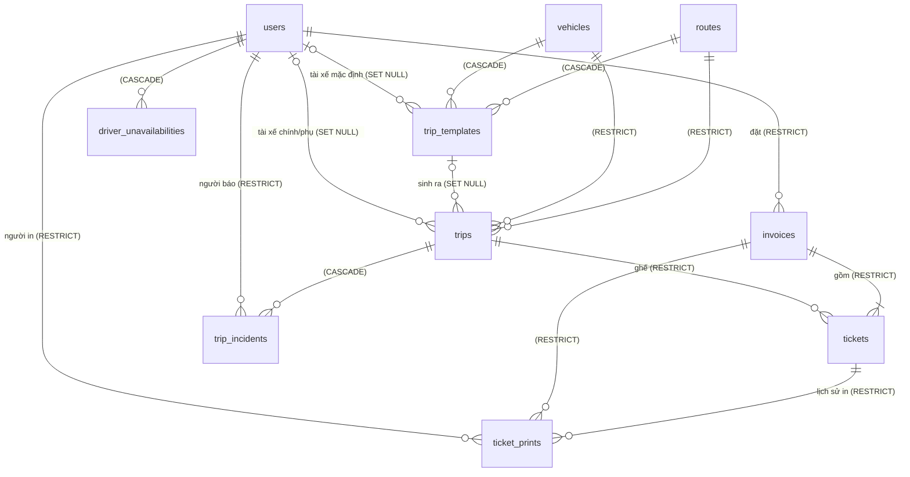

# Thiết kế lại hệ thống Database

> Trạng thái: **đã triển khai** (2026-10-10) trên XAMPP — `bus_ticket_dev` đã migrate + seed; checklist mục 13 đã chạy trên `bus_ticket_test`.
> Đã chốt: (1) dùng **XAMPP (MariaDB 10.4) trước**, người học tự chuyển sang Docker sau (mục 12); (2) **seed lại**, không cứu dữ liệu ngày 8/10 (chỉ giữ bản chép file `.ibd`); (3) đổi FK của các bảng tài chính sang **RESTRICT**.
> Khác bản thiết kế: (1) CHECK `chk_tickets_active_seat`/`chk_trip_incidents_delay` thêm `IS NOT NULL` (CHECK coi NULL là đạt); (2) CHECK tài xế phụ ≠ chính viết `co_driver_id IS NULL OR driver_id IS NULL OR …`; (3) `mapDbError` chỉ gắn vào handler có ghi dữ liệu; (4) trên Windows bảng lịch sử migration tên `sequelize_meta` (chữ thường).

## 1. Sự cố & nguyên nhân

| Dấu hiệu (kiểm tra 2026-10-09) | Ý nghĩa |
|---|---|
| `C:\xampp\mysql\data\bus_ticket_db\` còn 10 file `.ibd` (8/10) nhưng **không có file `.frm`** | MariaDB 10.4 mất định nghĩa bảng, dữ liệu nằm "mồ côi" trong `.ibd` |
| `aria_log*` ngày **21/10/2019**, `ibdata1`/`ib_logfile*` vừa ghi mới, LSN ~300k | Toàn bộ InnoDB bị reset về bản gốc XAMPP — gần như chắc chắn do chép `C:\xampp\mysql\backup` đè lên `data` (cách "sửa" lỗi *MySQL shutdown unexpectedly*) |
| Ban đầu lỗi `doesn't exist in engine`, sau đó `doesn't exist`, `information_schema` trống | DB hiện tại coi như rỗng |

**Không phải lỗi code/schema.** Nhưng sự cố cho thấy 3 điểm yếu khiến không khôi phục được:

1. Không có bản sao lưu nào.
2. Schema dựng bằng `sequelize.sync({ force: true })` (`db:sync`, xóa sạch) + các script vá tay (`addDriverFeatures.js`, `addShuttlePickup.js`) — không có lịch sử phiên bản, không biết DB đang ở "phiên bản schema" nào.
3. Ràng buộc nghiệp vụ quan trọng (không xóa lịch sử tiền, ghế không âm…) chỉ nằm trong code; DB để `ON DELETE CASCADE`, ai xóa thẳng bằng phpMyAdmin là mất dữ liệu tài chính.

## 2. Mục tiêu & nguyên tắc

| # | Nguyên tắc |
|---|---|
| P1 | **Schema = migration có phiên bản.** Mọi thay đổi schema là một file migration mới; không sửa migration đã chạy; không dùng `sync()` ở bất kỳ đâu. |
| P2 | **DB tự bảo vệ dữ liệu tài chính**: FK `RESTRICT` cho hóa đơn/vé/chuyến, `CHECK` cho các bất biến (ghế, giá, trạng thái vé). Code vẫn kiểm tra trước để trả lỗi tiếng Việt; DB là lớp chặn cuối. |
| P3 | **Không phụ thuộc nền tảng**: chỉ dùng tính năng chạy giống nhau trên MariaDB 10.4 và MySQL 8.x. Mọi thông số kết nối/công cụ đọc từ `.env`. Đổi XAMPP → Docker chỉ là đổi `.env`. |
| P4 | **Lệnh phá hủy phải có rào chắn**: chỉ chạy trên DB tên `*_dev`/`*_test`, `NODE_ENV !== 'production'`, bắt buộc cờ `--yes`, tự sao lưu trước. |
| P5 | **Sao lưu được bằng một lệnh** và khôi phục được bằng một lệnh. |
| P6 | Giữ nguyên các quyết định thiết kế đang đúng: 1 hóa đơn = 1 lần thanh toán, 1 vé = 1 ghế; `active_seat_number` + `uq_trip_active_seat` chống bán trùng; tiền dùng `DECIMAL(10,2)`; kết nối `timezone: '+07:00'`, `DATETIME` lưu giờ Việt Nam; `typeCast` trong `config/db.js`. |

## 3. Môi trường

| Mục | Giá trị |
|---|---|
| DB server (hiện tại) | XAMPP — MariaDB 10.4.32, `localhost:3306` |
| DB chạy app | `bus_ticket_dev` (đổi từ `bus_ticket_db`) |
| DB thử nghiệm | `bus_ticket_test` — dùng cho chạy thử migration/seed/script, **không bao giờ** thử trên `_dev` |
| Charset/collation | `utf8mb4` / `utf8mb4_unicode_ci` (đặt rõ ở `CREATE DATABASE` và trong `define` của Sequelize — chạy giống nhau trên MariaDB và MySQL 8) |
| `.env.example` (mới, commit vào repo) | `DB_HOST`, `DB_PORT`, `DB_NAME=bus_ticket_dev`, `DB_USER`, `DB_PASS`, `MYSQLDUMP_PATH=C:\xampp\mysql\bin\mysqldump.exe`, `MYSQL_PATH=C:\xampp\mysql\bin\mysql.exe`, `BACKUP_DIR=backups`, `BACKUP_KEEP=10` + các biến ứng dụng hiện có |

## 4. Mô hình dữ liệu



Mọi bảng có `id INT AUTO_INCREMENT PK`, `created_at`, `updated_at` (`DATETIME NOT NULL`). Ký hiệu: **[MỚI]** cột/ràng buộc mới, **[ĐỔI]** thay đổi so với hiện tại.

### 4.1. `users`
| Cột | Kiểu | Ghi chú |
|---|---|---|
| full_name | VARCHAR(100) NOT NULL | |
| email | VARCHAR(100) NOT NULL **UNIQUE** | |
| phone | VARCHAR(15) NULL | **[MỚI]** index `idx_users_phone` (tìm khách theo SĐT ở quầy) |
| password | VARCHAR(255) NOT NULL | bcrypt |
| role | ENUM(customer, staff, admin, driver) NOT NULL DEFAULT customer | **[ĐỔI]** NOT NULL |
| is_active | BOOLEAN NOT NULL DEFAULT TRUE | **[ĐỔI]** NOT NULL |

### 4.2. `routes`
| Cột | Kiểu | Ghi chú |
|---|---|---|
| origin, destination | VARCHAR(100) NOT NULL | **[MỚI]** UNIQUE `uq_routes_origin_destination` (code tạo tuyến chiều về đã giả định không trùng) |
| distance_km | FLOAT NULL | CHECK `> 0` |
| duration_min | INT NULL | CHECK `> 0` |
| base_price | DECIMAL(10,2) NOT NULL | CHECK `> 0` |
| is_active | BOOLEAN NOT NULL DEFAULT TRUE | |
| origin_station, shuttle_enabled, shuttle_area_note | (xem `DonKhachTrungChuyen.md`) | |

### 4.3. `vehicles`
| Cột | Kiểu | Ghi chú |
|---|---|---|
| license_plate | VARCHAR(20) NOT NULL UNIQUE | |
| vehicle_type | ENUM(sleeper, limousine, standard) NOT NULL | |
| total_seats | INT NOT NULL | CHECK `> 0` |
| seat_layout | JSON NULL | MariaDB: LONGTEXT + `JSON_VALID` tự động; MySQL 8: JSON thật (xem 12.3) |
| is_active | BOOLEAN NOT NULL DEFAULT TRUE | |

### 4.4. `trip_templates`
route_id, vehicle_id (NOT NULL), departure_time_of_day CHAR(5) "HH:mm", duration_minutes, price, available_seats, days_of_week JSON, driver_id?, co_driver_id?, is_active.
CHECK: `price > 0`, `available_seats >= 0`, `duration_minutes IS NULL OR duration_minutes > 0`, `co_driver_id IS NULL OR co_driver_id <> driver_id`.

### 4.5. `trips`
route_id, vehicle_id, departure_time, arrival_time?, available_seats, price, status ENUM(scheduled, ongoing, completed, cancelled), template_id?, driver_id?, co_driver_id?, reminder_sent_at?, actual_departure_at?, actual_arrival_at?, shuttle_locked_at?, shuttle_list_printed_at?.
CHECK: `available_seats >= 0`, `price > 0`, `arrival_time IS NULL OR arrival_time > departure_time`, `co_driver_id IS NULL OR co_driver_id <> driver_id`.
Cố ý **không** đặt CHECK "có tài xế phụ thì phải có tài xế chính" (quy tắc của `validateDriverPair`): khi xóa tài xế chính, FK `SET NULL` sẽ làm chuyến cũ vi phạm CHECK đó và chặn luôn việc xóa — quy tắc này giữ ở tầng code.

### 4.6. `invoices`
| Cột | Kiểu | Ghi chú |
|---|---|---|
| user_id | INT NOT NULL | FK `RESTRICT` **[ĐỔI]** |
| total_price | DECIMAL(10,2) NOT NULL | CHECK `>= 0` (hủy lẻ có thể về 0 trước khi hóa đơn bị xóa/hoàn) |
| payment_method | ENUM(cash, momo) NOT NULL DEFAULT cash | |
| payment_status | ENUM(pending, paid, refunded) NOT NULL DEFAULT pending | |
| paid_at | DATETIME NULL | **[MỚI]** thời điểm chuyển sang `paid`. CHECK `payment_status = 'pending' OR paid_at IS NOT NULL` (đã/hoàn tiền thì phải từng được trả) |

### 4.7. `tickets`
invoice_id, trip_id, seat_number, active_seat_number?, passenger_name, passenger_phone, ticket_price, booking_status, cancelled_at?, issued_at?/issued_by?/print_count, boarded_at?/boarded_by?, pickup_type/pickup_address?/pickup_note?/pickup_updated_at?.

CHECK — đưa các bất biến đang chỉ nằm trong code xuống DB:
- `seat_number >= 1`, `ticket_price > 0`, `print_count >= 0`
- **`(booking_status = 'booked' AND active_seat_number = seat_number) OR (booking_status = 'cancelled' AND active_seat_number IS NULL)`** — đây chính là quy tắc "luôn giữ `active_seat_number` đồng bộ với `booking_status`" trong CLAUDE.md, giờ DB tự chặn nếu code quên.
- `pickup_type = 'station' OR pickup_address IS NOT NULL`

### 4.8. `ticket_prints`, `trip_incidents`, `driver_unavailabilities`
- `ticket_prints`: CHECK `print_sequence >= 1`; **[MỚI]** FK `invoice_id → invoices` (hiện chưa có FK).
- `trip_incidents`: CHECK `type <> 'delay' OR delay_minutes > 0`.
- `driver_unavailabilities`: CHECK `start_date <= end_date`.

## 5. Chính sách khóa ngoại

| FK | Hiện tại | Mới | Lý do |
|---|---|---|---|
| invoices.user_id → users | CASCADE | **RESTRICT** | Không bao giờ để xóa user cuốn theo hóa đơn |
| tickets.invoice_id → invoices | CASCADE | **RESTRICT** | Xóa hóa đơn `pending` phải xóa vé trước một cách tường minh (mục 10) |
| tickets.trip_id → trips | CASCADE | **RESTRICT** | |
| trips.route_id / vehicle_id | CASCADE | **RESTRICT** | |
| ticket_prints.ticket_id / printed_by | CASCADE / (không ghi) | **RESTRICT** | Nhật ký đối soát |
| ticket_prints.invoice_id | (không có) | **RESTRICT** [MỚI] | |
| trip_incidents.reported_by | (mặc định) | **RESTRICT** | |
| tickets.issued_by, tickets.boarded_by, trip_incidents.resolved_by | (không có FK) | **SET NULL** [MỚI] | Trỏ tới user có thật |
| trips/trip_templates.driver_id, co_driver_id; trips.template_id | SET NULL | SET NULL | Giữ |
| trip_templates.route_id / vehicle_id | CASCADE | CASCADE | Cấu hình, không phải lịch sử tiền |
| trip_incidents.trip_id, driver_unavailabilities.driver_id | CASCADE | CASCADE | Dữ liệu phụ |

Tất cả `ON UPDATE CASCADE`. Associations trong `models/index.js` đổi `onDelete` tương ứng và **bỏ `hooks: true`** ở các quan hệ RESTRICT (không để Sequelize tự xóa con ở tầng ứng dụng).

## 6. Index

| Bảng | Index | Dùng cho |
|---|---|---|
| tickets | `uq_trip_active_seat (trip_id, active_seat_number)` UNIQUE | chống bán trùng (giữ) |
| tickets | `idx_tickets_trip_pickup (trip_id, pickup_type)` | danh sách đón (giữ) |
| tickets | `idx_tickets_invoice (invoice_id)` **[MỚI]** | vé theo hóa đơn |
| invoices | `idx_invoices_user_created (user_id, created_at)` **[MỚI]** | lịch sử hóa đơn của khách |
| invoices | `idx_invoices_status_created (payment_status, created_at)` **[MỚI]** | job hủy hóa đơn hết hạn, lọc của quầy |
| trips | `idx_trips_status_departure (status, departure_time)` **[MỚI]** | các job định kỳ, `GET /api/trips` |
| trips | `idx_trips_route_departure (route_id, departure_time)` **[MỚI]** | tìm chuyến công khai |
| trips | `idx_trip_template_departure`, `idx_trips_driver`, `idx_trips_co_driver` | (giữ) |
| users | `idx_users_phone` **[MỚI]** | tìm khách theo SĐT |
| ticket_prints, trip_incidents, driver_unavailabilities, trip_templates | các index hiện có | (giữ) |

## 7. Migration

**Công cụ:** `umzug` v3 + `SequelizeStorage` (bảng `SequelizeMeta` ghi migration đã chạy). Chọn umzug thay `sequelize-cli` vì dùng thẳng instance `sequelize` + `.env` đang có, không cần thêm `config.json`.

```
backend/
  migrations/
    20261010000001-baseline.js         # toàn bộ schema mục 4–6 (bảng, FK, CHECK, index)
  src/db/
    migrator.js                         # cấu hình umzug, dùng chung cho CLI và test
    safety.js                           # rào chắn P4 + tự sao lưu
  src/scripts/
    migrate.js                          # db:migrate | db:migrate:undo | db:status
    resetDb.js                          # db:reset
    backupDb.js, restoreDb.js           # mục 9
    seedData.js, seedDrivers.js         # giữ
```

**Quy tắc viết migration:**
- Tên `YYYYMMDDHHmmss-mo-ta.js`, export `up({ context: queryInterface })` và `down(...)`.
- Mỗi migration chạy trong 1 transaction khi có thể (lưu ý: DDL của MySQL/MariaDB tự commit — migration phải viết sao cho chạy lại được nếu đứt giữa chừng, ví dụ kiểm tra `describeTable` trước khi `addColumn`).
- CHECK/FK đặt tên rõ ràng (`chk_tickets_active_seat`, `fk_tickets_invoice`) bằng `queryInterface.addConstraint` hoặc SQL thuần.
- **Không sửa migration đã được chạy ở bất kỳ máy nào**; muốn đổi thì viết migration mới.
- Model (`src/models/*.js`) vẫn mô tả cột để Sequelize truy vấn, nhưng **không còn là nguồn tạo bảng**. Mỗi PR đổi schema phải sửa cả migration lẫn model.

**Lệnh npm (backend):**

| Lệnh | Làm gì | Rào chắn |
|---|---|---|
| `db:create` | `CREATE DATABASE IF NOT EXISTS <DB_NAME>` với utf8mb4 | — |
| `db:migrate` | Chạy các migration chưa chạy | — |
| `db:migrate:undo` | Lùi 1 migration | P4 + tự sao lưu |
| `db:status` | Liệt kê đã chạy / chưa chạy | — |
| `db:seed` | Nạp dữ liệu mẫu (xóa dữ liệu cũ như hiện tại) | P4 |
| `db:reset` | Sao lưu → xóa toàn bộ bảng → `db:migrate` → `db:seed` | P4 |
| `db:backup` / `db:restore -- <file>` | Mục 9 | restore: P4 |
| ~~`db:sync`~~, ~~`db:add-driver`~~, ~~`db:add-shuttle`~~ | **Bỏ** (file xóa, lịch sử còn trong git) | |

**Rào chắn P4** (`src/db/safety.js`): từ chối nếu `NODE_ENV === 'production'`, hoặc `DB_NAME` không kết thúc bằng `_dev`/`_test`, hoặc thiếu `--yes`; in rõ đang thao tác trên host/DB nào trước khi chạy.

## 8. Seed

- Giữ `seedData.js` (nội dung demo hiện tại). Thứ tự xóa ở bước 1 đã đúng chiều con → cha nên chạy được với RESTRICT.
- Bổ sung `paid_at` cho mọi hóa đơn `paid`/`refunded` (bắt buộc vì CHECK ở 4.6).
- `db:seed` kiểm tra `SequelizeMeta` đã có baseline, nếu chưa thì báo "Hãy chạy `npm run db:migrate` trước".

## 9. Sao lưu & khôi phục

- `db:backup`: gọi `MYSQLDUMP_PATH --single-transaction --routines --default-character-set=utf8mb4 <DB_NAME>` → `backend/backups/<DB_NAME>-YYYYMMDD-HHmmss.sql` (Node tự nén `.gz`), giữ `BACKUP_KEEP` bản mới nhất. `backups/` thêm vào `.gitignore`.
- `db:restore -- <file>`: rào chắn P4, sao lưu trạng thái hiện tại trước, rồi nạp file bằng `MYSQL_PATH`.
- Tự sao lưu trước `db:reset`, `db:migrate:undo`, `db:restore`.
- Không dùng thư mục `C:\xampp\mysql\backup` cho bất kỳ việc gì.

## 10. Thay đổi code cần làm

| File | Thay đổi |
|---|---|
| `src/config/db.js` | `define.charset/collate` utf8mb4; giữ `typeCast`, `timezone` |
| `src/models/index.js` | `onDelete` theo mục 5; bỏ `hooks: true` ở quan hệ RESTRICT; thêm association `TicketPrint.belongsTo(Invoice)` |
| `src/models/*.js` | Thêm `paid_at`; đồng bộ `allowNull`/index với migration |
| `invoiceController.cancelInvoice`, `ticketController.cancelTicket`, `tripController.update` (hủy chuyến), `jobs/expireInvoices.js` | Trước `invoice.destroy()` gọi `Ticket.destroy({ where: { invoice_id }, transaction })` (hóa đơn `pending` chưa thể có `ticket_prints` vì in vé yêu cầu `paid`) |
| `invoiceController.updateStatus`, `paymentController.applyMomoResult` | Ghi `paid_at = now` khi `pending → paid` |
| Các controller | Bắt thêm lỗi vi phạm CHECK/FK (`SequelizeForeignKeyConstraintError`, lỗi CHECK MariaDB `ER_CONSTRAINT_FAILED` 4025 / MySQL `ER_CHECK_CONSTRAINT_VIOLATED` 3819) → trả 400/409 tiếng Việt chung, log chi tiết. Code vẫn kiểm tra trước như hiện tại. |
| `package.json` | Thêm `umzug`; cập nhật scripts mục 7 |
| `.env.example`, `.gitignore` | Mới / thêm `backups/` |
| `CLAUDE.md`, `PROJECT_MAP.md`, `README.md` | Thay hướng dẫn `db:sync`/`db:add-*` bằng luồng migration; DDL tham chiếu chuyển thành "xem `migrations/`" |

## 11. Khôi phục XAMPP ngay bây giờ

1. Dừng backend (`npm run dev`).
2. Chép 10 file `C:\xampp\mysql\data\bus_ticket_db\*.ibd` sang `backend/backups/orphan-ibd-2026-10-08/` (phòng khi cần cứu dữ liệu).
3. Xóa các file `.ibd` mồ côi khỏi thư mục data (nếu không, tạo bảng cùng tên sẽ lỗi *Tablespace exists*).
4. `DROP DATABASE bus_ticket_db;` (DB rỗng, không còn định nghĩa bảng).
5. `npm run db:create && npm run db:migrate && npm run db:seed`.
6. Đổi `DB_NAME` trong `.env` thành `bus_ticket_dev`.

**Tránh lặp lại:** luôn **Stop MySQL** trong XAMPP Control Panel trước khi tắt máy; khi gặp *MySQL shutdown unexpectedly* **không chép `mysql\backup` đè `data`** — xem log `mysql_error.log`, rồi khôi phục bằng `npm run db:restore`.

## 12. Chuyển sang Docker (người học tự làm sau)

### 12.1. `docker-compose.yml` mẫu (đặt ở thư mục gốc)
```yaml
services:
  db:
    image: mysql:8.4
    container_name: banvexe-db
    restart: unless-stopped
    environment:
      MYSQL_ROOT_PASSWORD: ${DB_PASS}
      MYSQL_DATABASE: bus_ticket_dev
      TZ: Asia/Ho_Chi_Minh
    command:
      - --character-set-server=utf8mb4
      - --collation-server=utf8mb4_unicode_ci
    ports:
      - "3307:3306"        # 3307 để chạy song song với XAMPP (3306) trong lúc chuyển
    volumes:
      - banvexe-db-data:/var/lib/mysql
    healthcheck:
      test: ["CMD", "mysqladmin", "ping", "-h", "localhost", "-p${DB_PASS}"]
      interval: 10s
      retries: 5
volumes:
  banvexe-db-data:
```

### 12.2. Các bước
1. `docker compose up -d`, chờ healthcheck `healthy`.
2. Đổi `.env`: `DB_PORT=3307`, `DB_PASS=<mật khẩu root của container>`; `MYSQLDUMP_PATH`/`MYSQL_PATH` trỏ tới bản cài MySQL client, hoặc đổi script dùng `docker exec banvexe-db mysqldump ...`.
3. Chọn một: (a) DB sạch: `npm run db:migrate && npm run db:seed`; (b) mang dữ liệu sang: `npm run db:backup` khi `.env` còn trỏ XAMPP → đổi `.env` → `npm run db:restore -- <file>`.
4. Chạy checklist mục 13.
5. Khi ổn định: tắt MySQL trong XAMPP.

### 12.3. Điểm phải kiểm tra lại khi sang MySQL 8
- **`typeCast` JSON**: MariaDB gửi cột JSON dưới dạng `BLOB` (LONGTEXT); MySQL 8 gửi kiểu `JSON` thật. `typeCast` hiện tại xử lý cả hai — phải test `seat_layout`, `days_of_week` không bị mã hóa hai lần.
- **`DATEONLY`** (`driver_unavailabilities.start_date/end_date`) vẫn trả về chuỗi `YYYY-MM-DD`.
- **Xác thực**: MySQL 8.4 mặc định `caching_sha2_password` — `mysql2` hỗ trợ sẵn; công cụ cũ (phpMyAdmin của XAMPP) có thể không kết nối được.
- **Dump từ MariaDB nạp vào MySQL**: nếu lỗi collation `utf8mb4_unicode_ci`/cú pháp CHECK, dùng phương án (a) rồi seed lại.

## 13. Checklist kiểm tra

- [ ] `db:migrate` trên DB trống tạo đủ 10 bảng + `SequelizeMeta`; chạy lần 2 không làm gì.
- [ ] `db:migrate:undo` rồi `db:migrate` lại không lỗi.
- [ ] `db:reset` từ chối khi thiếu `--yes`, khi `DB_NAME=bus_ticket_db`, khi `NODE_ENV=production`.
- [ ] `db:seed` chạy xong; mọi hóa đơn `paid`/`refunded` có `paid_at`.
- [ ] Thử vi phạm bằng SQL thuần: xóa user có hóa đơn → bị chặn; `UPDATE tickets SET active_seat_number=NULL` trên vé `booked` → bị CHECK chặn; `available_seats = -1` → bị chặn.
- [ ] Luồng app: đặt vé, hủy vé lẻ / hủy cả hóa đơn `pending` (xóa được) và `paid` (thành refunded), hết hạn giữ chỗ, hủy chuyến, in vé, điểm danh, đổi cách lên xe, in danh sách đón.
- [ ] `db:backup` tạo file; `db:restore` file đó vào `bus_ticket_test` cho ra số dòng giống nhau.
- [ ] `node --check` các file backend đã sửa; `npm run build` frontend (không đổi nhưng chạy để chắc).

## 14. Thứ tự triển khai

1. Khôi phục XAMPP theo mục 11, bước 1–4 (chép rồi xóa `.ibd`, drop DB).
2. `migrator.js`, `safety.js`, các script và npm scripts (mục 7, 9); `.env.example`, `.gitignore`.
3. Migration baseline (mục 4–6); sửa models/associations (mục 5, 10).
4. Sửa code luồng xóa hóa đơn `pending`, ghi `paid_at`, bắt lỗi ràng buộc.
5. Sửa seed (`paid_at`); `db:create` → `db:migrate` → `db:seed` trên `bus_ticket_test`, chạy checklist; rồi làm lại trên `bus_ticket_dev`.
6. Xóa `syncDb.js`, `addDriverFeatures.js`, `addShuttlePickup.js`; cập nhật tài liệu.
